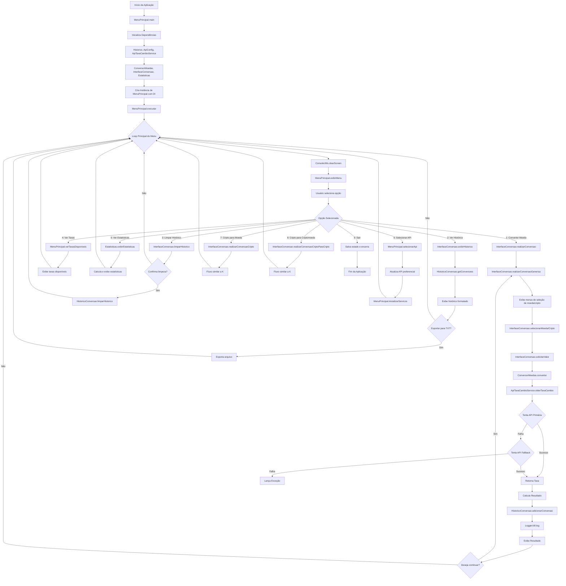
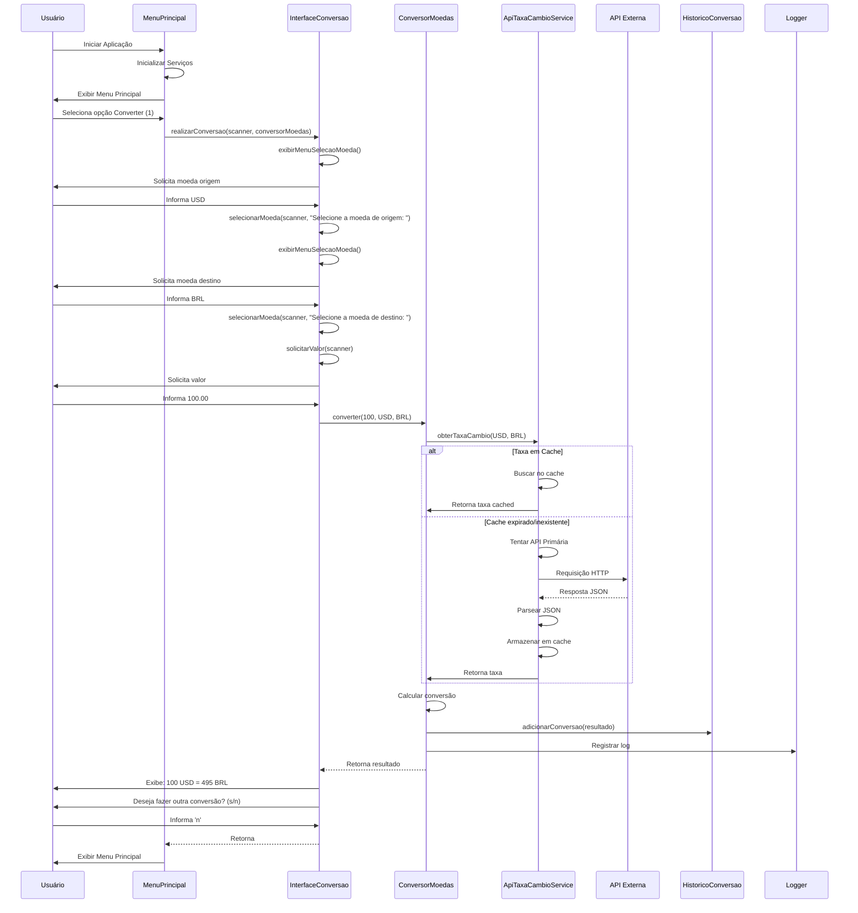

<h1 align="center">Conversor de Moedas</h1>

<p align="center">
  
  
  
  
  
  
</p>

## 📋 Descrição
O Conversor de Moedas é uma aplicação Java console que permite converter valores entre 15 moedas diferentes e diversas criptomoedas, usando taxas de câmbio em tempo real. A aplicação oferece histórico de conversões, logs detalhados e estatísticas de uso.

## ⚙️ Funcionalidades
- ✅ Conversão entre 15 moedas fiduciárias (ARS, BOB, BRL, CLP, COP, USD, EUR, GBP, JPY, AUD, CAD, CHF, CNY, MXN, INR)
- ✅ Conversão entre diversas criptomoedas (BTC, ETH, USDT, BNB, SOL, XRP, USDC, ADA, AVAX, DOGE)
- ✅ Conversão entre moedas fiduciárias e criptomoedas
- ✅ Taxas de câmbio atualizadas em tempo real através de múltiplas APIs (ExchangeRate-API, OpenExchangeRates, CoinGecko)
- ✅ Cache de taxas para otimizar performance e reduzir chamadas à API
- ✅ Histórico completo de conversões com persistência em arquivo JSON
- ✅ Sistema de logs detalhado para monitoramento de operações e erros
- ✅ Estatísticas de uso (total de conversões, moedas mais utilizadas, valores médios)
- ✅ Interface interativa via console com menus claros e validação de entrada
- ✅ Suporte para múltiplas APIs de câmbio com seleção de API preferencial
- ✅ Fallback automático entre APIs em caso de falha
- ✅ Exportação do histórico de conversões para arquivo TXT

## 🛠️ Tecnologias Utilizadas
- **Java JDK 17**: Linguagem de programação
- **Gson 2.10.1**: Biblioteca para serialização/desserialização JSON
- **Lombok 1.18.30**: Redução de boilerplate code (getters, setters, construtores)
- **HttpClient**: Módulo nativo do Java 11+ para requisições HTTP
- **ExchangeRate-API**: API principal para taxas de câmbio fiduciárias
- **OpenExchangeRates**: API alternativa para taxas de câmbio fiduciárias (fallback)
- **CoinGecko**: API para taxas de câmbio de criptomoedas
- **java.util.logging**: Sistema de logs integrado do Java
- **Scanner**: Interface de usuário via console para entrada de dados

## 🔄 Fluxogramas

```mermaid
classDiagram
    class Main {
        +main(String[] args)
    }
    
    class MenuPrincipal {
        -Scanner scanner
        -ConversorMoedas conversorMoedas
        -HistoricoConversao historicoConversao
        -InterfaceConversao interfaceConversao
        -Estatisticas estatisticas
        -ApiProvider preferredApi
        +MenuPrincipal(ConversorMoedas, HistoricoConversao, InterfaceConversao, Estatisticas)
        +exibirMenu()
        +executar()
        -inicializarServicos()
        -selecionarApi()
        -realizarConversao()
        -verHistorico()
        -limparHistorico()
        -verTaxasDisponiveis()
        -verEstatisticas()
        -realizarConversaoCripto()
        -realizarConversaoCriptoParaCripto()
    }
    
    class Moeda {
        <<enumeration>>
        +codigo: String
        +nomeCompleto: String
        +simbolo: String
        +tipo: MoedaType
        +isCrypto(): boolean
        +isFiat(): boolean
        +fromCodigo(String): Moeda
    }

    class MoedaType {
        <<enumeration>>
        FIAT
        CRYPTO
    }
    
    class TaxaCambio {
        +origem: Moeda
        +destino: Moeda
        +taxa: double
        +timestamp: LocalDateTime
    }
    
    class ConversaoResultado {
        +valorOriginal: double
        +moedaOrigem: Moeda
        +valorConvertido: double
        +moedaDestino: Moeda
        +taxaUtilizada: double
        +dataHora: LocalDateTime
    }
    
    class ConversorMoedas {
        -ApiTaxaCambio apiTaxaCambio
        -HistoricoConversao historicoConversao
        +converter(double, Moeda, Moeda): ConversaoResultado
    }
    
    class ApiTaxaCambio {
        <<interface>>
        +obterTaxaCambio(Moeda, Moeda) TaxaCambio
    }

    class ApiTaxaCambioService {
        -ApiTaxaCambio primaryApi
        -ApiTaxaCambio fallbackApi
        -ApiTaxaCambio coinGeckoApi
        -Map~String,TaxaCambio~ cacheTaxas
        +ApiTaxaCambioService(ApiConfig, ApiProvider)
        +obterTaxaCambio(Moeda, Moeda): TaxaCambio
        -obterTaxaCambioCripto(Moeda, Moeda): TaxaCambio
        -isCacheValid(TaxaCambio): boolean
        +limparCacheExpirado()
    }

    class ApiProvider {
        <<enumeration>>
        EXCHANGERATE_API
        OPENEXCHANGERATES
        +getName(): String
        +fromString(String): ApiProvider
    }

    class ApiTaxaCambioFactory {
        +getApiImplementation(ApiProvider, ApiConfig): ApiTaxaCambio
    }
    
    class ExchangeRateApiImpl {
        -HttpClient client
        -ApiConfig apiConfig
        -JsonParser jsonParser
        +ExchangeRateApiImpl(ApiConfig)
        +obterTaxaCambio(Moeda, Moeda): TaxaCambio
    }

    class OpenExchangeRatesApiImpl {
        -HttpClient client
        -Gson gson
        -String appId
        +OpenExchangeRatesApiImpl(String)
        +obterTaxaCambio(Moeda, Moeda): TaxaCambio
        -parseOpenExchangeRatesResponse(String, Moeda, Moeda): double
    }

    class CoinGeckoApiImpl {
        -HttpClient client
        -Gson gson
        -String apiKey
        +CoinGeckoApiImpl(String)
        +obterTaxaCambio(Moeda, Moeda): TaxaCambio
        -parseCoinGeckoResponse(String, Moeda, Moeda): double
    }
    
    class HistoricoConversao {
        -Gson gson
        -List~ConversaoResultado~ conversoes
        +HistoricoConversao()
        +adicionarConversao(ConversaoResultado)
        +getUltimasConversoes(int): List~ConversaoResultado~
        +limparHistorico()
        +estaVazio(): boolean
        +salvarEmArquivo()
        -carregarDeArquivo()
    }

    class Estatisticas {
        -HistoricoConversao historicoConversao
        +Estatisticas(HistoricoConversao)
        +exibirEstatisticas()
        -getTotalConversoes(List~ConversaoResultado~): int
        -getMoedaMaisConvertida(List~ConversaoResultado~): Moeda
        -getValorTotalConvertidoPorMoeda(List~ConversaoResultado~): Map~Moeda,Double~
        -getMediaValoresConvertidos(List~ConversaoResultado~): double
        -gerarGraficoFrequenciaMoedas(List~ConversaoResultado~)
    }
    
    class InterfaceConversao {
        -Logger logger
        +exibirMenuSelecaoMoeda()
        +exibirMenuSelecaoCripto()
        -selecionarMoedaGenerica(Scanner, String, Predicate~Moeda~): Moeda
        +selecionarCripto(Scanner, String): Moeda
        +selecionarMoeda(Scanner, String): Moeda
        +solicitarValor(Scanner): double
        -perguntarContinuarConversao(Scanner): boolean
        -realizarConversaoGenerica(Scanner, ConversorMoedas, Runnable, Function~Scanner,Moeda~, Runnable, Function~Scanner,Moeda~)
        +realizarConversao(Scanner, ConversorMoedas)
        +realizarConversaoCripto(Scanner, ConversorMoedas)
        +realizarConversaoCriptoParaCripto(Scanner, ConversorMoedas)
        +exibirHistorico(Scanner, HistoricoConversao)
        +limparHistorico(Scanner, HistoricoConversao)
        -exportarHistoricoParaTxt(List~ConversaoResultado~)
    }
    
    class ApiConfig {
        -static ApiConfig instance
        -apiKey: String
        -openExchangeRatesAppId: String
        -coinGeckoApiKey: String
        -BASE_URL: String
        -COINGECKO_BASE_URL: String
        +getInstance(): ApiConfig
        -loadApiKey()
        +buildPairConversionUrl(String, String): String
        +buildCoinGeckoSimplePriceUrl(String, String): String
    }
    
    class JsonParser {
        -Gson gson
        +JsonParser(Gson)
        +parseConversionRate(String, String, String): double
    }
    
    class LoggerUtil {
        +getLogger(String): Logger
    }

    class ConsoleUtils {
        +clearScreen()
        +waitForEnter(Scanner)
        +solicitarDouble(Scanner, String, String, Predicate~Double~): double
    }

    Main --> MenuPrincipal
    MenuPrincipal --> ConversorMoedas
    MenuPrincipal --> HistoricoConversao
    MenuPrincipal --> InterfaceConversao
    MenuPrincipal --> Estatisticas
    MenuPrincipal --> ApiProvider
    MenuPrincipal --> ConsoleUtils
    ConversorMoedas --> ApiTaxaCambio
    ConversorMoedas --> HistoricoConversao
    ApiTaxaCambioService ..|> ApiTaxaCambio
    ApiTaxaCambioService --> ApiConfig
    ApiTaxaCambioService --> ApiProvider
    ApiTaxaCambioService --> ApiTaxaCambioFactory
    ApiTaxaCambioFactory --> ApiTaxaCambio
    ApiTaxaCambioFactory --> ApiConfig
    ExchangeRateApiImpl ..|> ApiTaxaCambio
    ExchangeRateApiImpl --> ApiConfig
    ExchangeRateApiImpl --> JsonParser
    OpenExchangeRatesApiImpl ..|> ApiTaxaCambio
    CoinGeckoApiImpl ..|> ApiTaxaCambio
    HistoricoConversao --> ConversaoResultado
    HistoricoConversao --> LoggerUtil
    Estatisticas --> HistoricoConversao
    Estatisticas --> Moeda
    InterfaceConversao --> ConversorMoedas
    InterfaceConversao --> HistoricoConversao
    InterfaceConversao --> Moeda
    InterfaceConversao --> ConsoleUtils
    InterfaceConversao --> LoggerUtil
    JsonParser --> Gson
    Moeda --> MoedaType
```






## 📦 Estrutura do Projeto
```
conversor-moedas/
├── src/
│   └── main/
│       └── java/
│           └── com/
│               └── conversor/
│                   ├── Main.java
│                   ├── MenuPrincipal.java
│                   ├── InterfaceConversao.java
│                   ├── Estatisticas.java
│                   ├── models/
│                   │   ├── Moeda.java
│                   │   ├── TaxaCambio.java
│                   │   ├── ConversaoResultado.java
│                   │   └── HistoricoConversao.java
│                   ├── services/
│                   │   ├── ApiTaxaCambio.java
│                   │   ├── ApiTaxaCambioService.java
│                   │   ├── ApiTaxaCambioFactory.java
│                   │   ├── ApiProvider.java
│                   │   ├── ExchangeRateApiImpl.java
│                   │   ├── OpenExchangeRatesApiImpl.java
│                   │   ├── CoinGeckoApiImpl.java
│                   │   └── ConversorMoedas.java
│                   └── utils/
│                       ├── ApiConfig.java
│                       ├── ConsoleUtils.java
│                       ├── JsonParser.java
│                       └── LoggerUtil.java
├── data/
│   └── historico.json
├── logs/
│   └── conversoes.log
├── docs/
│   ├── capturas/
│   └── fluxogramas/
├── .gitignore
├── README.md
├── API_SETUP.md
├── TESTES.md
├── DOCUMENTACAO.md
└── pom.xml
```

## 🚀 Como Executar

### Pré-requisitos
- Java JDK 17 ou superior instalado
- Apache Maven instalado
- Conexão com internet
- Chaves das APIs ExchangeRate-API, OpenExchangeRates e CoinGecko (gratuitas)

### Configuração
1. Clone o repositório:
   ```bash
   git clone https://github.com/dessima/conversor-moedas.git
   cd conversor-moedas
   ```
2. Obtenha suas chaves das APIs:
   - **ExchangeRate-API**: Registre-se em [https://www.exchangerate-api.com/](https://www.exchangerate-api.com/) e obtenha sua chave gratuita.
   - **OpenExchangeRates**: Registre-se em [https://openexchangerates.org/](https://openexchangerates.org/) e obtenha seu App ID gratuito.
   - **CoinGecko**: Registre-se em [https://www.coingecko.com/api](https://www.coingecko.com/api) e obtenha sua chave gratuita (se necessário, para acesso a dados mais abrangentes).
3. Configure as variáveis de ambiente com suas chaves:
   - `EXCHANGERATE_API_KEY=SUA_CHAVE_EXCHANGERATE`
   - `OPENEXCHANGERATES_APP_ID=SEU_APP_ID_OPENEXCHANGERATES`
   - `COINGECKO_API_KEY=SUA_CHAVE_COINGECKO`
   (No Windows, você pode definir variáveis de ambiente temporariamente no terminal com `set VAR=VALOR` ou permanentemente nas configurações do sistema. No Linux/macOS, use `export VAR=VALOR` ou adicione ao seu `.bashrc`/`.zshrc`).

### Compilação e Execução
1. Compile o projeto usando Maven:
   ```bash
   mvn clean install
   ```
2. Execute a aplicação:
   ```bash
   java -jar target/conversor-moedas-1.0-SNAPSHOT.jar
   ```
   (Certifique-se de que o nome do JAR corresponde ao gerado pelo Maven, que pode variar ligeiramente.)

## 👨‍💻 Autor

<p>
    <a href="https://www.linkedin.com/in/dessim">
        
    </a>
    <a href="https://github.com/dessima">
        
    </a>
</p>

<p>
    Feito com ❤️ por <strong>José Anderson</strong>
</p>

---

## 📄 Licença
Este projeto está sob a licença MIT. Veja o arquivo [LICENSE](LICENSE) para mais detalhes.