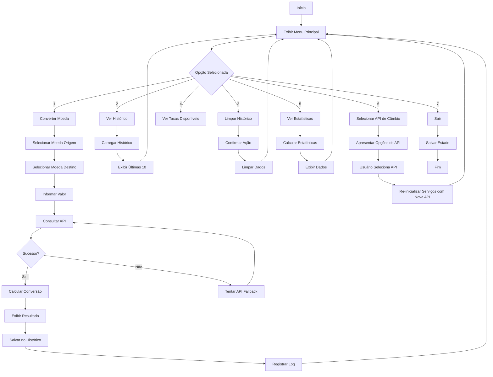
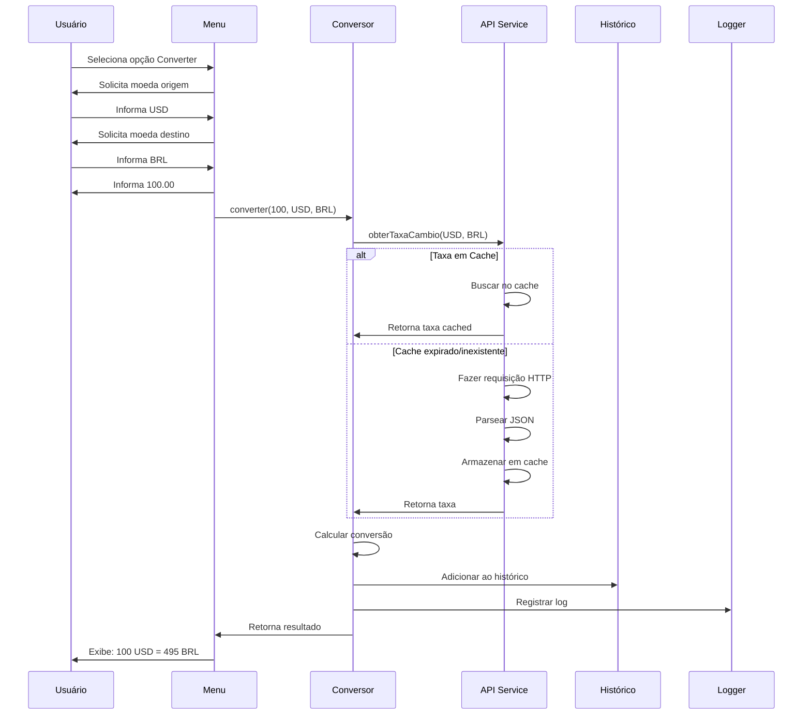
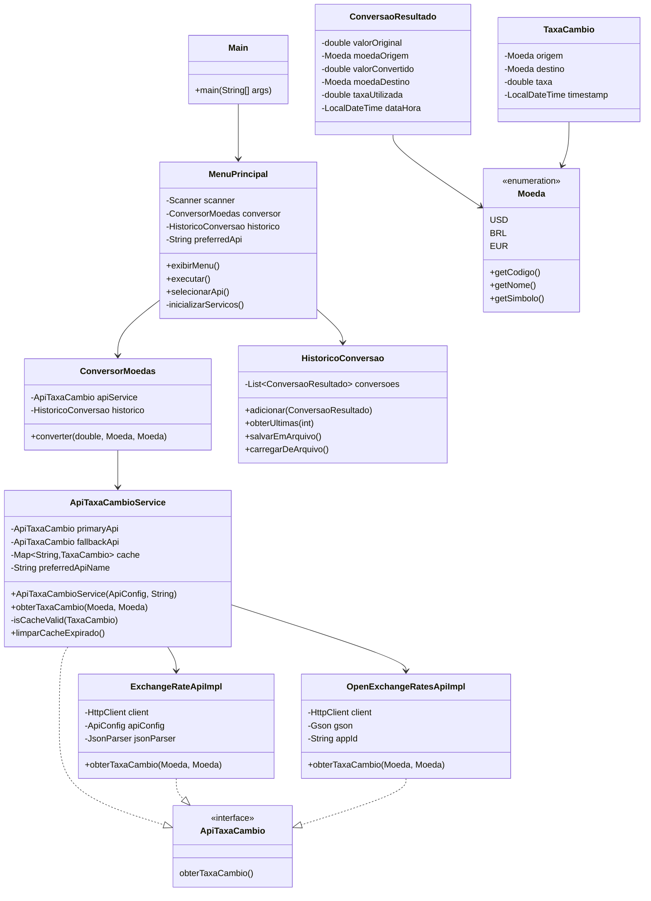

# Conversor de Moedas

## 📋 Descrição
O Conversor de Moedas é uma aplicação Java console que permite converter valores entre 15 moedas diferentes usando taxas de câmbio em tempo real. A aplicação oferece histórico de conversões, logs detalhados e estatísticas de uso. O usuário pode selecionar a API de câmbio preferencial (ExchangeRate-API ou OpenExchangeRates) no início da execução.

## ⚙️ Funcionalidades
- ✅ Conversão entre 15 moedas diferentes (ARS, BOB, BRL, CLP, COP, USD, EUR, GBP, JPY, AUD, CAD, CHF, CNY, MXN, INR)
- ✅ Taxas de câmbio atualizadas em tempo real
- ✅ Cache de taxas para otimizar performance
- ✅ Histórico completo de conversões
- ✅ Persistência de dados em arquivo JSON
- ✅ Sistema de logs detalhado
- ✅ Estatísticas de uso
- ✅ Interface interativa via console
- ✅ Suporte para múltiplas APIs de câmbio (ExchangeRate-API e OpenExchangeRates)
- ✅ Fallback automático entre APIs
- ✅ **Seleção de API preferencial pelo usuário**

## 🛠️ Tecnologias Utilizadas
- **Java JDK 17**: Linguagem de programação
- **Gson 2.10.1**: Serialização/desserialização JSON
- **HttpClient**: Requisições HTTP (Java 11+)
- **ExchangeRate-API**: API principal de taxas de câmbio
- **OpenExchangeRates**: API alternativa (fallback)
- **java.util.logging**: Sistema de logs
- **Scanner**: Interface de usuário via console

## 🔄 Fluxogramas

### FLUXO PRINCIPAL DA APLICAÇÃO


### FLUXO DE CONVERSÃO DETALHADO


### ESTRUTURA DE CLASSES


## 📦 Estrutura do Projeto
```
conversor-moedas/
├── .env.example
├── .gitignore
├── API_SETUP.md
├── pom.xml
├── README.md
├── TESTES.md
├── .git/
├── .idea/
├── data/
│   ├── historico.json
│   └── historico.json.bak
├── docs/
│   ├── capturas/
│   └── fluxogramas/
├── logs/
├── src/
│   └── main/
│       └── java/
│           └── com/
│               └── conversor/
│                   ├── Estatisticas.java
│                   ├── InterfaceConversao.java
│                   ├── Main.java
│                   ├── MenuPrincipal.java
│                   ├── models/
│                   │   ├── ConversaoResultado.java
│                   │   ├── HistoricoConversao.java
│                   │   ├── Moeda.java
│                   │   └── TaxaCambio.java
│                   ├── services/
│                   │   ├── ApiTaxaCambio.java
│                   │   ├── ApiTaxaCambioService.java
│                   │   ├── ConversorMoedas.java
│                   │   ├── ExchangeRateApiImpl.java
│                   │   └── OpenExchangeRatesApiImpl.java
│                   └── utils/
│                       ├── ApiConfig.java
│                       ├── JsonParser.java
│                       └── LoggerUtil.java
└── target/
    ├── classes/
    ├── generated-sources/
    ├── maven-archiver/
    └── maven-status/
```

## 🚀 Como Executar

### Pré-requisitos
- Java JDK 17 ou superior instalado
- Conexão com internet
- Chaves das APIs ExchangeRate e OpenExchangeRates (ambas gratuitas, mas a OpenExchangeRates requer registro para um App ID)

### Configuração
1. Clone o repositório.
2. Obtenha sua chave da API ExchangeRate em https://www.exchangerate-api.com/.
3. Obtenha seu App ID da OpenExchangeRates em https://openexchangerates.org/ (registro gratuito).
4. **Defina as variáveis de ambiente** para as chaves das APIs. Crie um arquivo `.env` na raiz do projeto (não versionado) ou defina-as diretamente no seu sistema operacional:
   ```
   EXCHANGERATE_API_KEY=SUA_CHAVE_EXCHANGERATE_AQUI
   OPENEXCHANGERATES_APP_ID=SEU_APP_ID_OPENEXCHANGERATES_AQUI
   ```
   Consulte o arquivo `API_SETUP.md` para instruções detalhadas sobre como configurar essas variáveis.
5. Configure a biblioteca Gson no IntelliJ (se estiver usando IDE).

### Execução
```bash
javac -cp .:gson-2.10.1.jar src/main/java/com/conversor/*.java
java -cp .:gson-2.10.1.jar com.conversor.Main
```

## 📸 Capturas de Tela
Para adicionar as capturas de tela, salve as imagens na pasta `docs/capturas/` e atualize esta seção com os links.

- `menu-principal.png` - Menu inicial com todas as opções
- `conversao-sucesso.png` - Exemplo de conversão bem-sucedida (USD para BRL)
- `historico.png` - Visualização do histórico com múltiplas conversões
- `estatisticas.png` - Tela de estatísticas completa
- `erro-api.png` - Exemplo de tratamento de erro amigável

## 🎥 Vídeo Demonstrativo
Para adicionar o vídeo demonstrativo, faça o upload para uma plataforma (ex: YouTube, Vimeo) e insira o link aqui.

[Link do vídeo ou GIF animado mostrando uso da aplicação - A ser adicionado pelo usuário]

## 👨‍💻 Autor
**José Anderson da Silva Costa**

<a href="https://www.linkedin.com/in/dessim"></a>
<a href="https://github.com/dessima"></a>

## 📄 Licença
Este projeto está sob a licença MIT.