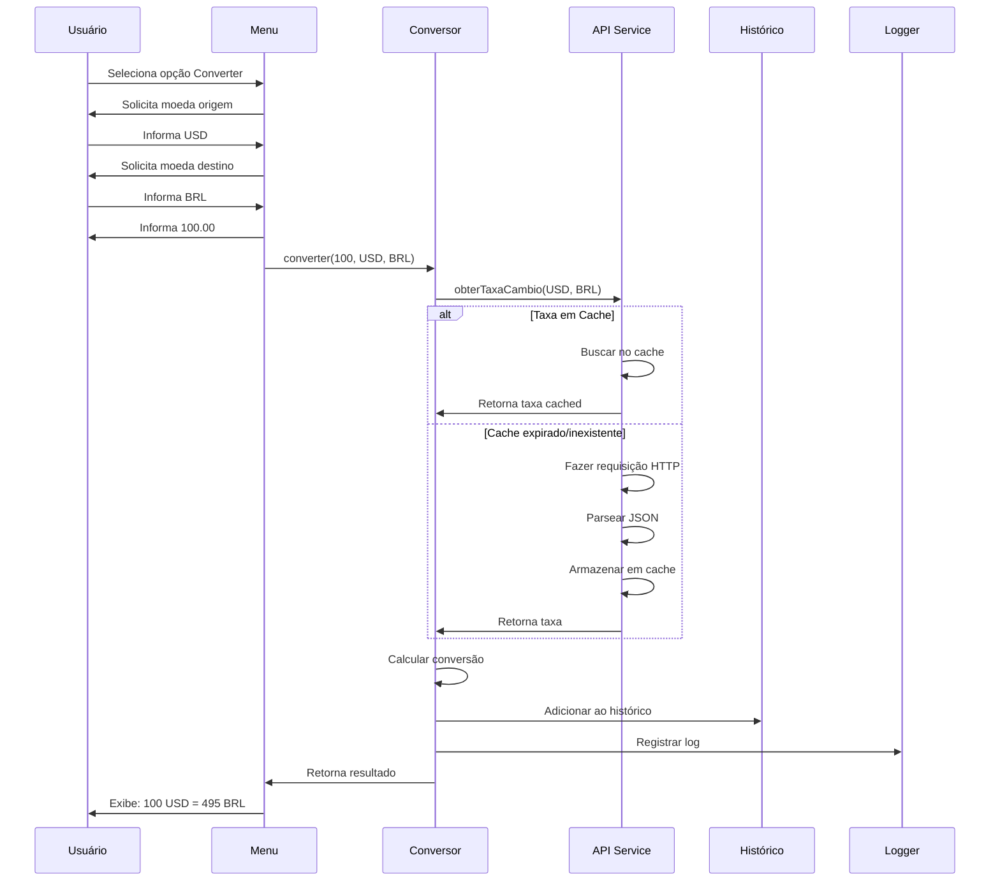

# Conversor de Moedas

## 📋 Descrição
O Conversor de Moedas é uma aplicação Java console que permite converter valores entre 15 moedas diferentes usando taxas de câmbio em tempo real. A aplicação oferece histórico de conversões, logs detalhados e estatísticas de uso.

## ⚙️ Funcionalidades
✅ Conversão entre 15 moedas diferentes (ARS, BOB, BRL, CLP, COP, USD, EUR, GBP, JPY, AUD, CAD, CHF, CNY, MXN, INR)
✅ Taxas de câmbio atualizadas em tempo real
✅ Cache de taxas para otimizar performance
✅ Histórico completo de conversões
✅ Persistência de dados em arquivo JSON
✅ Sistema de logs detalhado
✅ Estatísticas de uso
✅ Interface interativa via console
✅ Suporte para múltiplas APIs de câmbio
✅ Fallback automático entre APIs

## 🛠️ Tecnologias Utilizadas
- **Java JDK 17**: Linguagem de programação
- **Gson 2.10.1**: Serialização/desserialização JSON
- **HttpClient**: Requisições HTTP (Java 11+)
- **ExchangeRate-API**: API principal de taxas de câmbio
- **OpenExchangeRates**: API alternativa (fallback)
- **java.util.logging**: Sistema de logs
- **Scanner**: Interface de usuário via console

## 🔄 Fluxogramas

### FLUXO PRINCIPAL DA APLICAÇÃO

```mermaid
flowchart TD
    A[Início] --> B[Exibir Menu Principal]
    B --> C{Opção Selecionada}
    C -->|1| D[Converter Moeda]
    C -->|2| E[Ver Histórico]
    C -->|3| F[Limpar Histórico]
    C -->|4| G[Ver Estatísticas]
    C -->|5| H[Sair]
    
    D --> I[Selecionar Moeda Origem]
    I --> J[Selecionar Moeda Destino]
    J --> K[Informar Valor]
    K --> L[Consultar API]
    L --> M{Sucesso?}
    M -->|Sim| N[Calcular Conversão]
    M -->|Não| O[Tentar API Fallback]
    O --> M
    N --> P[Exibir Resultado]
    P --> Q[Salvar no Histórico]
    Q --> R[Registrar Log]
    R --> B
    
    E --> S[Carregar Histórico]
    S --> T[Exibir Últimas 10]
    T --> B
    
    F --> U[Confirmar Ação]
    U --> V[Limpar Dados]
    V --> B
    
    G --> W[Calcular Estatísticas]
    W --> X[Exibir Dados]
    X --> B
    
    H --> Y[Salvar Estado]
    Y --> Z[Fim]
```


### FLUXO DE CONVERSÃO DETALHADO


### ESTRUTURA DE CLASSES
```mermaid
classDiagram
    class Main {
        +main(String[] args)
    }
    
    class MenuPrincipal {
        -Scanner scanner
        -ConversorMoedas conversor
        -HistoricoConversao historico
        +exibirMenu()
        +executar()
    }
    
    class Moeda {
        <<enumeration>>
        USD
        BRL
        EUR
        +getCodigo()
        +getNome()
        +getSimbolo()
    }
    
    class TaxaCambio {
        -Moeda origem
        -Moeda destino
        -double taxa
        -LocalDateTime timestamp
    }
    
    class ConversaoResultado {
        -double valorOriginal
        -Moeda moedaOrigem
        -double valorConvertido
        -Moeda moedaDestino
        -double taxaUtilizada
        -LocalDateTime dataHora
    }
    
    class ConversorMoedas {
        -ApiTaxaCambio apiService
        -HistoricoConversao historico
        +converter(double, Moeda, Moeda)
    }
    
    class ApiTaxaCambioService {
        -ApiTaxaCambio primaryApi
        -ApiTaxaCambio fallbackApi
        -Map~String,TaxaCambio~ cache
        +obterTaxaCambio(Moeda, Moeda)
        -isCacheValid(TaxaCambio)
        +limparCacheExpirado()
    }

    interface ApiTaxaCambio {
        +obterTaxaCambio(Moeda, Moeda)
    }
    
    class ExchangeRateApiImpl {
        -HttpClient client
        -ApiConfig apiConfig
        -JsonParser jsonParser
        +obterTaxaCambio(Moeda, Moeda)
    }

    class OpenExchangeRatesApiImpl {
        -HttpClient client
        -Gson gson
        -String appId
        +obterTaxaCambio(Moeda, Moeda)
    }
    
    class HistoricoConversao {
        -List~ConversaoResultado~ conversoes
        +adicionar(ConversaoResultado)
        +obterUltimas(int)
        +salvarEmArquivo()
        +carregarDeArquivo()
    }
    
    Main --> MenuPrincipal
    MenuPrincipal --> ConversorMoedas
    MenuPrincipal --> HistoricoConversao
    ConversorMoedas --> ApiTaxaCambioService
    ApiTaxaCambioService ..|> ApiTaxaCambio
    ApiTaxaCambioService --> ExchangeRateApiImpl
    ApiTaxaCambioService --> OpenExchangeRatesApiImpl
    ExchangeRateApiImpl ..|> ApiTaxaCambio
    OpenExchangeRatesApiImpl ..|> ApiTaxaCambio
    ConversaoResultado --> Moeda
    TaxaCambio --> Moeda
```

## 📦 Estrutura do Projeto
```
conversor-moedas/
├── src/
│   └── main/
│       └── java/
│           └── com/
│               └── conversor/
│                   ├── Main.java
│                   ├── MenuPrincipal.java
│                   ├── models/
│                   │   ├── Moeda.java
│                   │   ├── TaxaCambio.java
│                   │   ├── ConversaoResultado.java
│                   │   └── HistoricoConversao.java
│                   ├── services/
│                   │   ├── ApiTaxaCambio.java
│                   │   ├── ExchangeRateApiImpl.java
│                   │   ├── OpenExchangeRatesApiImpl.java
│                   │   ├── ApiTaxaCambioService.java
│                   │   └── ConversorMoedas.java
│                   └── utils/
│                       ├── ApiConfig.java
│                       ├── JsonParser.java
│                       └── LoggerUtil.java
├── data/
│   └── historico.json
├── logs/
│   └── conversoes.log
├── docs/
│   ├── capturas/
│   └── fluxogramas/
├── .gitignore
├── README.md
└── API_SETUP.md
```

## 🚀 Como Executar

### Pré-requisitos
- Java JDK 17 ou superior instalado
- Conexão com internet
- Chave da API ExchangeRate (gratuita)

### Configuração
1. Clone o repositório.
2. Obtenha sua chave da API em https://www.exchangerate-api.com/.
3. **Defina as variáveis de ambiente** para as chaves das APIs. Consulte o arquivo `API_SETUP.md` para instruções detalhadas sobre como configurar `EXCHANGERATE_API_KEY` e `OPENEXCHANGERATES_APP_ID`.
4. Configure a biblioteca Gson no IntelliJ (se estiver usando IDE).
### Execução
```bash
javac -cp .:gson-2.10.1.jar src/main/java/com/conversor/*.java
java -cp .:gson-2.10.1.jar com.conversor.Main
```

## 📸 Capturas de Tela
Para adicionar as capturas de tela, salve as imagens na pasta `docs/capturas/` e atualize esta seção com os links.

- `menu-principal.png` - Menu inicial com todas as opções
- `conversao-sucesso.png` - Exemplo de conversão bem-sucedida (USD para BRL)
- `historico.png` - Visualização do histórico com múltiplas conversões
- `estatisticas.png` - Tela de estatísticas completa
- `erro-api.png` - Exemplo de tratamento de erro amigável

## 🎥 Vídeo Demonstrativo
Para adicionar o vídeo demonstrativo, faça o upload para uma plataforma (ex: YouTube, Vimeo) e insira o link aqui.

[Link do vídeo ou GIF animado mostrando uso da aplicação - A ser adicionado pelo usuário]

## 👨‍💻 Autor
[Seu Nome]
[LinkedIn/GitHub]

## 📄 Licença
Este projeto está sob a licença MIT.
