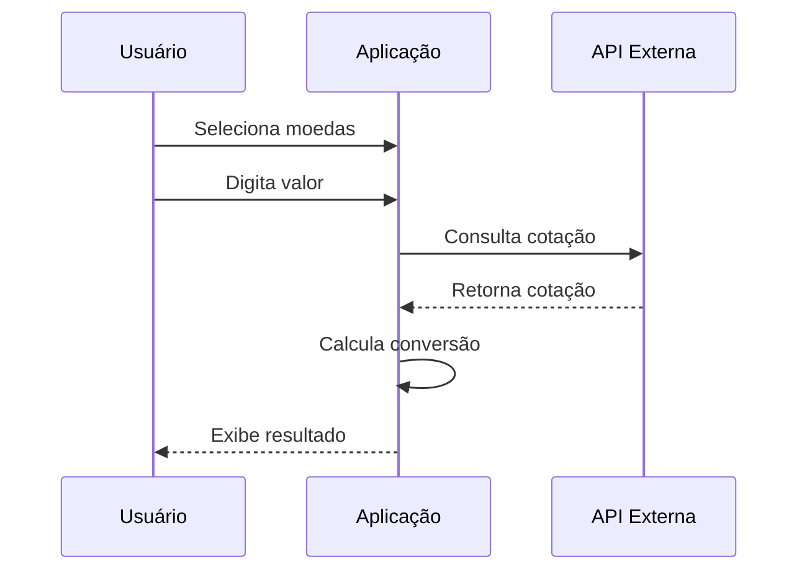
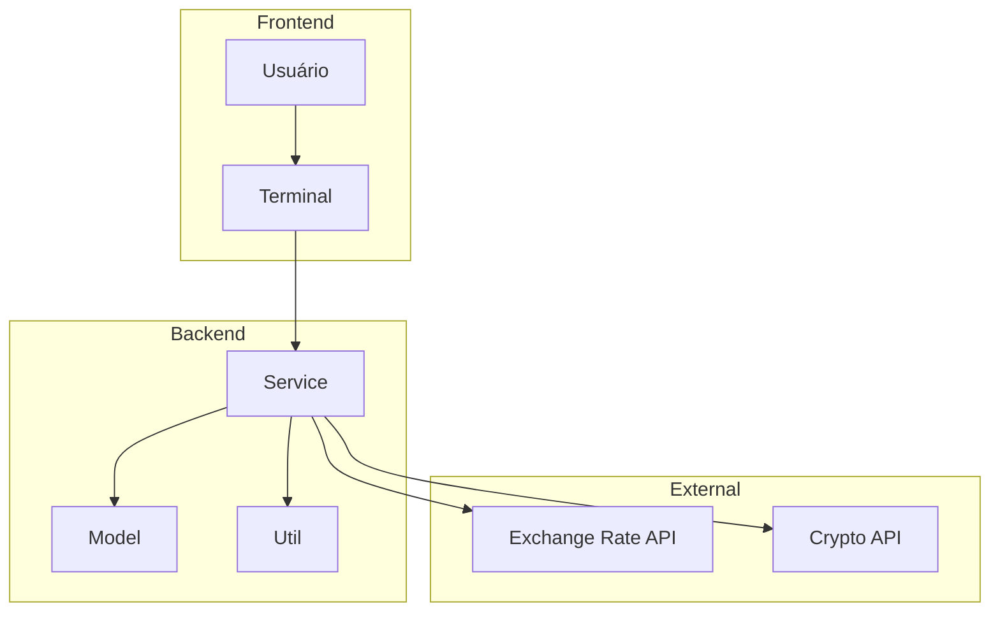
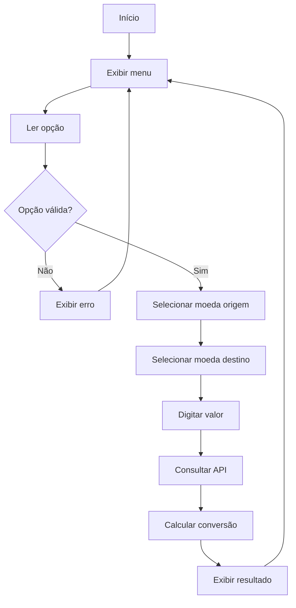

# Conversor de Moedas


O **Conversor de Moedas** é um conversor de moedas em Java 17 que interage com 15 moedas fiduciárias e diversas criptomoedas via APIs externas. Utiliza Gson para serialização JSON, Lombok para redução de boilerplate e HttpClient nativo para requisições HTTP.

## Índice

- [Visão Geral](#visão-geral)
- [Arquitetura de Software](#arquitetura-de-software)
- [Estrutura de Pastas](#estrutura-de-pastas)
- [Módulos e Responsabilidades](#módulos-e-responsabilidades)
- [Telas e Fluxo](#telas-e-fluxo)
- [Regras de Negócio](#regras-de-negócio)
- [Requisitos Funcionais](#requisitos-funcionais)
- [Requisitos Não Funcionais](#requisitos-não-funcionais)
- [Testes Automatizados](#testes-automatizados)
- [CI/CD](#cicd)
- [Contribuição](#contribuição)

## Visão Geral

O Conversor de Moedas é uma aplicação de console que permite converter valores entre diferentes moedas fiduciárias e criptomoedas. A aplicação consoma APIs externas para obter cotações em tempo real e realiza conversões precisas.

### Características Principais

- **Múltiplas Moedas**: 15 moedas fiduciárias e diversas criptomoedas
- **APIs Externas**: Cotações em tempo real
- **Gson**: Serialização e desserialização JSON
- **Lombok**: Redução de boilerplate
- **HttpClient Nativo**: Sem dependências externas para HTTP

### Moedas Suportadas

| Fiduciárias | Criptomoedas |
|-------------|--------------|
| BRL, USD, EUR | Bitcoin (BTC) |
| GBP, JPY, CAD | Ethereum (ETH) |
| AUD, CHF, CNY | Litecoin (LTC) |
| INR, KRW, MXN | Ripple (XRP) |
| SEK, NOK, DKK | Cardano (ADA) |

### Fluxo do Sistema



## Arquitetura de Software

A aplicação segue uma arquitetura simples com camadas bem definidas:

- **Model**: Entidades de dados (Moeda, Cotacao)
- **Service**: Lógica de negócio e consumo de APIs
- **Util**: Helpers e utilitários

### Diagrama de Arquitetura



## Estrutura de Pastas

```
Conversor-de-Moedas/
├── src/
│   ├── main/
│   │   ├── java/com/conversor/
│   │   │   ├── model/
│   │   │   │   ├── Moeda.java
│   │   │   │   └── Cotacao.java
│   │   │   ├── service/
│   │   │   │   ├── ConversorService.java
│   │   │   │   └── ApiClient.java
│   │   │   ├── util/
│   │   │   │   └── JsonUtil.java
│   │   │   └── ConversorApp.java
│   │   └── resources/
│   └── test/
│       └── java/com/conversor/
│           └── ConversorServiceTest.java
├── pom.xml
└── README.md
```

## Módulos e Responsabilidades

| Módulo | Responsabilidade | Tecnologia |
|--------|------------------|------------|
| Model | Entidades de dados | Java, Lombok |
| Service | Lógica de negócio | Java, HttpClient |
| Util | Helpers | Gson |

### Entidades do Sistema

| Entidade | Atributos | Descrição |
|----------|-----------|-----------|
| Moeda | codigo, nome, tipo | Representa uma moeda |
| Cotacao | moedaOrigem, moedaDestino, valor | Cotação atual |

## Telas e Fluxo

### Menu Principal

```
================================
    Conversor de Moedas
================================
1 - Converter moeda fiduciária
2 - Converter criptomoeda
3 - Ver cotação atual
4 - Listar moedas disponíveis
0 - Sair
================================
```

### Fluxo de Conversão



## Regras de Negócio

1. **Taxas de Câmbio**: Atualizadas em tempo real via API
2. **Precisão**: 4 casas decimais para moedas fiduciárias
3. **Criptomoedas**: 8 casas decimais
4. **Valor Mínimo**: R$ 0,01 para conversão
5. **Cache**: Cotações cacheadas por 5 minutos

## Requisitos Funcionais

| ID | Requisito | Prioridade |
|----|-----------|------------|
| RF-01 | Converter moedas fiduciárias | Alta |
| RF-02 | Converter criptomoedas | Alta |
| RF-03 | Consultar cotação atual | Média |
| RF-04 | Listar moedas disponíveis | Média |
| RF-05 | Validar entrada | Alta |

## Requisitos Não Funcionais

| ID | Requisito | Descrição |
|----|-----------|-----------|
| RNF-01 | Performance | Resposta em menos de 2s |
| RNF-02 | Disponibilidade | Tratamento de falhas de API |
| RNF-03 | Usabilidade | Interface clara e intuitiva |
| RNF-04 | Manutenabilidade | Código limpo e documentado |

## Testes Automatizados

### Tipos de Teste

| Tipo | Cobertura | Ferramenta |
|------|-----------|------------|
| Unitários | 85% | JUnit 5 |

### Comandos de Teste

```bash
# Executar todos os testes
mvn test

# Com cobertura
mvn jacoco:report
```

## CI/CD

| Workflow | Dispara em | O que faz |
|----------|------------|-----------|
| `test.yml` | Push/PR | Executa testes |
| `build.yml` | Merge | Build do JAR |

## Contribuição

1. Fork o projeto
2. Crie uma branch para sua feature (`git checkout -b feature/nova-funcionalidade`)
3. Commit suas mudanças (`git commit -m 'Adiciona nova funcionalidade'`)
4. Push para a branch (`git push origin feature/nova-funcionalidade`)
5. Abra um Pull Request

### Diretrizes de Contribuição

- Siga o padrão de código Java
- Escreva testes para novas funcionalidades
- Atualize a documentação quando necessário

## Autor

**José Anderson** ([@DessimA](https://github.com/DessimA))
[LinkedIn](https://www.linkedin.com/in/dessim/) | [Website](https://jasc-dessima-dev.vercel.app/)