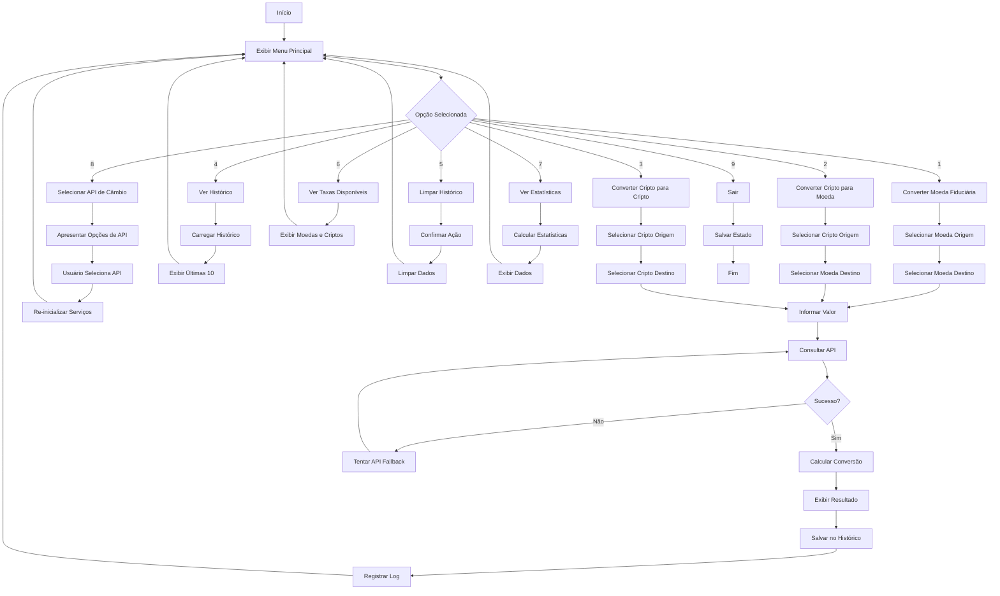
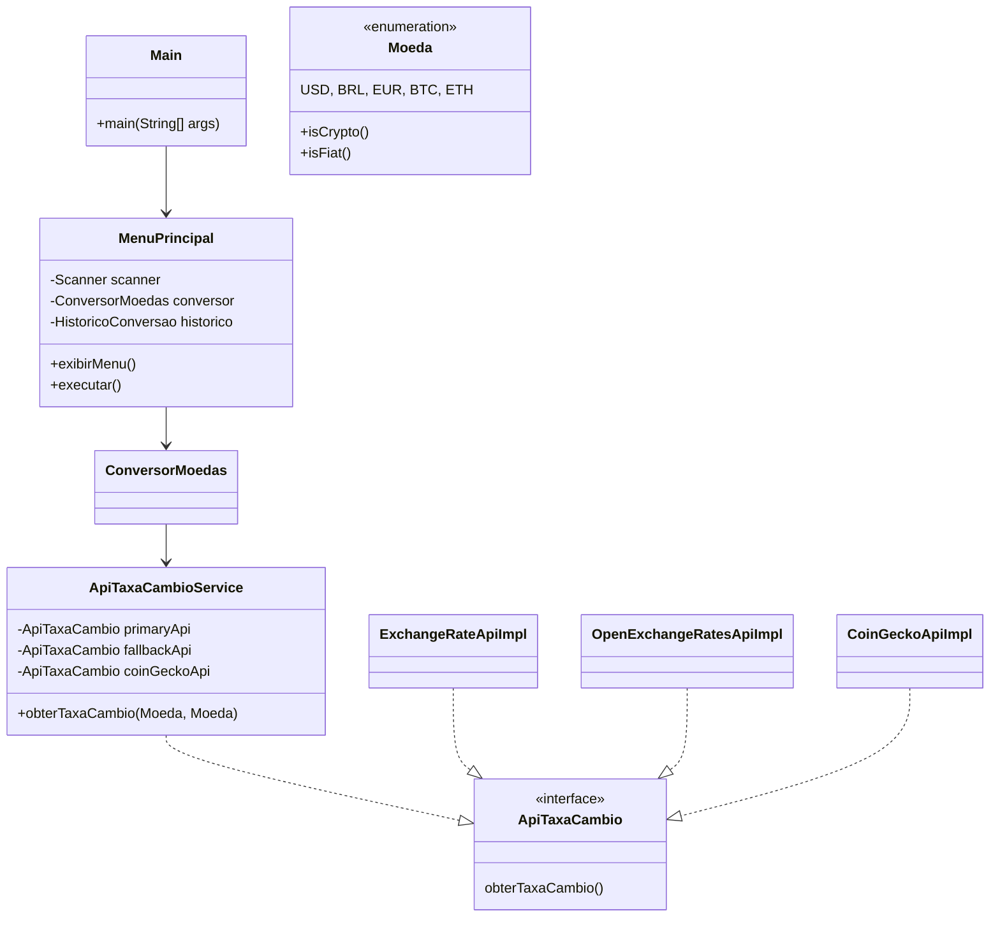

<h1 align="center">Conversor de Moedas</h1>

<p align="center">
  
  
  
  
</p>

## 📋 Descrição
O **Conversor de Moedas** é uma aplicação de console robusta, desenvolvida em Java, que permite a conversão de valores entre moedas fiduciárias e criptomoedas. Utilizando taxas de câmbio em tempo real de múltiplas APIs, a aplicação oferece uma experiência interativa e completa, com funcionalidades de histórico, logs e estatísticas de uso.

## ⚙️ Funcionalidades
- ✅ **Conversão Tripla:**
  - Moedas fiduciárias para moedas fiduciárias.
  - Criptomoedas para moedas fiduciárias.
  - Criptomoedas para criptomoedas.
- ✅ **Taxas de Câmbio em Tempo Real:** Cotações atualizadas para garantir precisão.
- ✅ **Cache Inteligente:** Sistema de cache para otimizar o uso das APIs e melhorar a performance.
- ✅ **Histórico de Conversões:** Todas as conversões são salvas para consulta futura.
- ✅ **Persistência de Dados:** O histórico é salvo em um arquivo JSON, garantindo que os dados não sejam perdidos.
- ✅ **Logs Detalhados:** Registro de todas as operações, requisições e erros em arquivos de log.
- ✅ **Estatísticas de Uso:** Análise de dados como a moeda mais convertida e o total de conversões.
- ✅ **Interface Interativa:** Um menu de console claro e fácil de usar.
- ✅ **Suporte a Múltiplas APIs:** Integração com `ExchangeRate-API`, `OpenExchangeRates` e `CoinGecko`.
- ✅ **Fallback Automático:** Se a API principal de moedas fiduciárias falha, uma API secundária é utilizada automaticamente.
- ✅ **Seleção de API:** O usuário pode escolher a API de preferência para moedas fiduciárias.

## 🛠️ Tecnologias Utilizadas
- **Java 17:** Linguagem principal da aplicação.
- **Gson 2.10.1:** Para manipulação de dados JSON.
- **HttpClient (Java 11+):** Para realizar requisições HTTP às APIs.
- **APIs de Câmbio:**
  - `ExchangeRate-API`: Fonte principal para taxas de moedas fiduciárias.
  - `OpenExchangeRates`: Fonte secundária (fallback) para moedas fiduciárias.
  - `CoinGecko`: Fonte para cotações de criptomoedas.
- **java.util.logging:** Para o sistema de logs da aplicação.

## 🔄 Fluxogramas

### FLUXO PRINCIPAL DA APLICAÇÃO


### ESTRUTURA DE CLASSES


## 📦 Estrutura do Projeto
```
conversor-moedas/
├── .env.example
├── .gitignore
├── API_SETUP.md
├── pom.xml
├── README.md
├── TESTES.md
├── data/
│   └── historico.json
├── logs/
│   └── conversoes.log
└── src/
    └── main/
        └── java/
            └── com/
                └── conversor/
                    ├── Main.java
                    ├── MenuPrincipal.java
                    ├── models/
                    ├── services/
                    └── utils/
```

## 🚀 Como Executar

### Pré-requisitos
- **Java JDK 17** ou superior
- Conexão com a internet
- Chaves de API para `ExchangeRate-API`, `OpenExchangeRates` e `CoinGecko`

### Configuração
1.  **Clone o repositório:**
    ```bash
    git clone https://github.com/seu-usuario/conversor-moedas.git
    ```
2.  **Obtenha as chaves de API:**
    - `ExchangeRate-API`: [exchangerate-api.com](https://www.exchangerate-api.com/)
    - `OpenExchangeRates`: [openexchangerates.org](https://openexchangerates.org/)
    - `CoinGecko`: [coingecko.com/api](https://www.coingecko.com/en/api)
3.  **Configure as variáveis de ambiente:**
    Crie um arquivo `.env` na raiz do projeto ou defina as variáveis no seu sistema. Consulte o `API_SETUP.md` para mais detalhes.
    ```
    EXCHANGERATE_API_KEY=SUA_CHAVE_AQUI
    OPENEXCHANGERATES_APP_ID=SEU_APP_ID_AQUI
    COINGECKO_API_KEY=SUA_CHAVE_AQUI
    ```
4.  **Instale as dependências:**
    Se estiver usando Maven, execute:
    ```bash
    mvn install
    ```

### Execução
Compile e execute a aplicação a partir da raiz do projeto:
```bash
javac -cp .:gson-2.10.1.jar src/main/java/com/conversor/*.java
java -cp .:gson-2.10.1.jar com.conversor.Main
```

---

## 👨‍💻 Autor

<p>
    <a href="https://www.linkedin.com/in/dessim">
        
    </a>
    <a href="https://github.com/dessima">
        
    </a>
</p>

<p>
    Feito com ❤️ por <strong>José Anderson</strong>
</p>

---

## 📄 Licença
Este projeto está sob a licença MIT. Veja o arquivo [LICENSE](LICENSE) para mais detalhes.